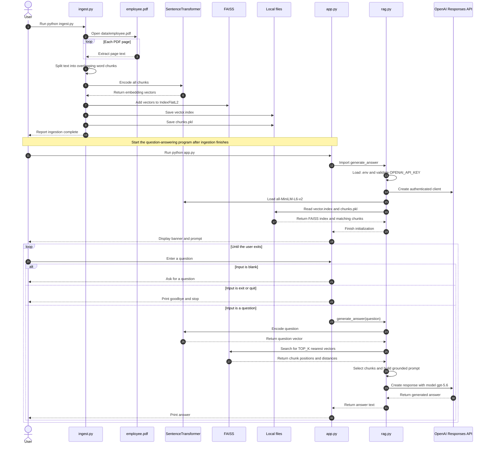

# Company Policy RAG Assistant

This document describes the current command-line application in `app.py`, its retrieval and answer logic in `rag.py`, and the PDF indexing pipeline in `ingest.py`. It includes line-number references for the current versions of those files. Blank lines in the source are only for readability; separator comments label sections and do not execute.

## What the application does

The application uses retrieval augmented generation (RAG). It first turns PDF text into small passages and searchable vectors. When a user asks a question, it finds the most similar passages, sends those passages with the question to the OpenAI Responses API, and prints the resulting answer.

There are two separate runs:

1. **Ingestion:** `ingest.py` reads `data/employee.pdf` and writes `vector.index` plus `chunks.pkl`.
2. **Question answering:** `app.py` loads those two files and starts a terminal question loop.

## Full application sequence diagram

The diagram shows the complete lifecycle: index the PDF first, then start the terminal app and ask questions. The ingestion and question-answering phases happen in separate program runs; the generated files connect them.



## Run it

Open PowerShell in the project directory. The Python launcher on this machine may need the full executable path:

```powershell
& 'C:\Users\Smat-Tech\AppData\Local\Programs\Python\Python314\python.exe' ingest.py
& 'C:\Users\Smat-Tech\AppData\Local\Programs\Python\Python314\python.exe' app.py
```

Run ingestion again whenever the PDF or chunking settings change. The app needs `OPENAI_API_KEY` in the project `.env` file and the generated index files in the working directory. Keep the API key private; do not paste it into source code or documentation. The first model load may download `all-MiniLM-L6-v2` from the model hub and can take longer than later runs.

## `app.py` explained line by line

Line numbers refer to `app.py` as it exists when this document was written.

| Lines | Explanation |
|---|---|
| 1 | Imports `generate_answer` from `rag.py`; this also runs the module-level setup in `rag.py` (loads the key, model, index, and chunks). |
| 4–6, 24–26, 67–69, 123–125 | Comment dividers and section titles. They are for readers and have no runtime effect. |
| 8 | Defines `display_header`, which prints the command-line welcome text. |
| 10 | Prints an empty line to space out the heading. |
| 11 | Prints a 70-character separator. Multiplying a string repeats it. |
| 12 | Prints the application title. |
| 13 | Prints another 70-character separator. |
| 15 | Prints a blank line. |
| 16–18 | Print a short description telling the user that questions are answered from the company policy PDF. |
| 19 | Prints a blank line. |
| 20 | Tells the user which words exit the interactive loop. |
| 21 | Prints the final separator for the banner. |
| 28 | Defines `process_question`, which takes one question string. |
| 30 | Starts a `try` block so errors from retrieval or the API can be displayed instead of immediately terminating this function. |
| 32 | Prints a blank line before the progress message. |
| 33 | Tells the user that search is underway. |
| 35–37 | Calls `generate_answer(question)` from `rag.py` and stores the returned answer. The call may embed the question, search FAISS, and call OpenAI. |
| 39 | Prints a blank line. |
| 40–42 | Print a separator, the `ASSISTANT` label, and another separator. |
| 44 | Prints a blank line before the answer. |
| 45 | Prints the answer returned by `rag.py`. |
| 47–48 | Add a blank line and a closing separator after the answer. |
| 50 | Catches any exception raised in the `try` block and names it `e`. |
| 52–54 | Print spacing, an error heading, and a separator. |
| 56–58 | Display the exception text so the user can see what failed. |
| 60–64 | Print a hint that the index-generation step may not have been run. This hint is generic; some errors can instead come from the missing API key or an API/network problem. |
| 71 | Defines `main`, the top-level command-line interaction. |
| 73 | Calls `display_header` once before asking for questions. |
| 75 | Starts an indefinite loop; it continues until the exit branch breaks out. |
| 77 | Prints spacing before each prompt. |
| 79–81 | Displays `You: `, waits for terminal input, removes whitespace from both ends, and stores it in `question`. |
| 83–85 | Comments marking the blank-input check. |
| 87 | Tests whether `question` is empty after trimming. |
| 89–91 | Ask the user to enter a question when input is empty. |
| 93 | `continue` skips the rest of this loop pass and shows the prompt again. |
| 95–97 | Comments marking the exit check. |
| 99–102 | Converts the question to lowercase and checks whether it equals `exit` or `quit`, making those commands case-insensitive. |
| 104–108 | Print a goodbye message when an exit command is entered. Adjacent string literals are joined by Python. |
| 110 | Prints a blank line after the goodbye. |
| 112 | `break` ends the `while True` loop and returns from `main`. |
| 114–116 | Comments marking question processing. |
| 118–120 | Pass the question to `process_question`; after it returns, the loop prompts for another question. |
| 127 | Checks whether Python is running this file directly, rather than importing it as a module. |
| 129 | Calls `main()` only for direct execution, so importing `app.py` does not start the prompt loop. |

## `rag.py` explained line by line

| Lines | Explanation |
|---|---|
| 1 | Imports `os` for environment-variable access and file-existence checks. |
| 2 | Imports `pickle` for reading the saved chunk list. Only load pickle files that you trust. |
| 4 | Imports FAISS, the vector-search library. |
| 5 | Imports NumPy for converting vectors to the format FAISS expects. |
| 7 | Imports `load_dotenv`, which reads values from a `.env` file into the process environment. |
| 8 | Imports the OpenAI client class used to call the Responses API. |
| 9 | Imports the sentence-transformers model class used to create question embeddings. |
| 12–14, 24–26, 35–37, 47–49, 56–58, 67–69, 86–88, 115–117, 170–172, 196–198, 266–268, 317–319 | Comment dividers and section labels; they visually group the following code but do not execute. |
| 16 | Sets the relative path for the saved FAISS index. The path is interpreted relative to the process's current working directory. |
| 17 | Sets the relative path for the pickled chunks. It must correspond to the same ingestion run as `vector.index`. |
| 19 | Chooses the local sentence-transformers model. Ingestion and query embedding must use the same model and compatible settings. |
| 21 | Sets the number of nearest chunks to retrieve for each question. |
| 28 | Loads `.env` values into environment variables. |
| 30–32 | Reads `OPENAI_API_KEY` from the environment; `os.getenv` returns `None` if it is absent. |
| 39 | Checks that a key was found before the rest of RAG setup continues. |
| 41–44 | Raises a clear `ValueError` during module import if the key is missing. Because `app.py` imports this module first, the prompt will not start until the key is configured. |
| 51–53 | Creates a reusable OpenAI client authenticated with the key. |
| 60 | Prints a startup status message. |
| 62–64 | Loads the local embedding model and stores it as `embedding_model`. Its model files may be downloaded on first use. |
| 71 | Prints a status message before loading the vector index. |
| 73 | Checks whether the FAISS index file exists. |
| 75–78 | Raises a `FileNotFoundError` with an instruction to run ingestion if the index is missing. |
| 81–83 | Reads the FAISS index from disk into the global `index` object. |
| 90 | Prints a status message before loading chunks. |
| 92 | Checks whether the chunk file exists. |
| 94–97 | Raises a `FileNotFoundError` with an ingestion hint if the chunk file is missing. |
| 100–103 | Opens `chunks.pkl` in binary-read mode and binds the open file to `file`. |
| 105–107 | Deserializes the pickled object and assigns it to `chunks`; these values are later matched to the FAISS result indexes. |
| 110–112 | Prints how many text chunks were loaded. |
| 119–122 | Defines `retrieve_documents(question, top_k=TOP_K)`. The default search count is the `TOP_K` setting. |
| 123–126 | Docstring explaining that the function embeds the question and searches the vector index. |
| 128 | Comment identifying question-embedding creation. |
| 129–132 | Encodes the question as a one-item list and requests a NumPy result. A list is used because model encoders accept batches. |
| 134 | Comment identifying the required numeric format conversion. |
| 135–137 | Converts the result to a NumPy array with 32-bit floating-point elements, matching FAISS's expected vector type. |
| 139 | Comment identifying the search operation. |
| 140–143 | Searches the index for `top_k` nearest vectors; `distances` holds L2 distances and `indexes` holds positions in the indexed chunk list. Lower L2 distance means closer vectors. |
| 145 | Creates an empty list for valid search results. |
| 147–149 | Iterates over the returned indexes while also tracking each result's position in the distance array. |
| 151–152 | Skips a negative FAISS index, which represents an unused result slot. |
| 154–155 | Skips indexes outside the chunk list, preventing an invalid chunk lookup. |
| 157–165 | Adds a dictionary per result. It contains the matched chunk text, its numeric distance, and its chunk index. |
| 167 | Returns the list of retrieved chunk dictionaries. |
| 174 | Defines `build_context`, which turns results into text for the language model. |
| 176 | Initializes a list to collect formatted passages. |
| 178–181 | Loops through the results, numbering them from one for display. |
| 183–189 | Adds a formatted `SOURCE` heading and the corresponding chunk text to the context list. |
| 191–193 | Joins the source blocks with newline separators and returns one context string. |
| 200 | Defines `generate_answer(question)`, the main RAG operation called by `app.py`. |
| 202 | Comment marking retrieval. |
| 203–205 | Calls `retrieve_documents` for the user's question. |
| 207 | Comment marking the empty-result case. |
| 208 | Checks whether retrieval returned any chunks. |
| 210–213 | Returns a fixed no-match response instead of calling OpenAI with empty context. |
| 215 | Comment marking context creation. |
| 216–218 | Formats the retrieved chunks by calling `build_context`. |
| 220 | Comment marking prompt creation. |
| 221–253 | Builds a multiline prompt. It instructs the language model to answer only from the retrieved policy context, gives a fallback answer, asks for a concise response, and inserts both the context and question. |
| 255 | Comment marking the API request. |
| 256–259 | Calls the OpenAI Responses API using the configured model name and prompt. This is where an API/network/model error can occur. |
| 261 | Extracts plain text from the API response. |
| 263 | Returns that answer to the caller in `app.py`. |
| 270–272 | Defines an optional helper to inspect the chunks retrieved for a question. |
| 273–276 | Docstring describing this diagnostic helper. |
| 278–280 | Retrieves the chunks for the given question. |
| 282–285 | Prints blank space, a separator, and a diagnostic heading. |
| 287 | Checks whether there are any retrieved documents. |
| 289 | Prints that no documents were found. |
| 291 | Returns early so the function does not try to display an empty result list. |
| 293–296 | Iterates through results, numbering them for display. |
| 298–303 | Print spacing, the result number, and a separator. |
| 305–308 | Prints the FAISS distance to four decimal places. |
| 310 | Prints a blank line. |
| 312–314 | Prints the retrieved chunk text. |
| 321 | Checks whether `rag.py` itself is being run as the command, rather than imported by `app.py`. |
| 323–326 | Print a blank line, separators, and a diagnostic test heading. |
| 328–330 | Prompts for one question and stores the typed text. |
| 332 | Checks whether the entered question is blank after trimming whitespace. |
| 334–336 | Ask the user to enter a question if it was blank. |
| 338 | Starts the branch for a nonblank question. |
| 340–343 | Prints the retrieved passages before the answer, which is useful for debugging retrieval. |
| 345–348 | Calls `generate_answer` and stores the generated answer. |
| 350–353 | Prints spacing, separators, and an answer heading. |
| 355–356 | Print a blank line and the answer text. |

## `ingest.py` explained line by line

| Lines | Explanation |
|---|---|
| 1 | Imports `PdfReader` to read and extract text from PDF pages. |
| 2 | Imports `SentenceTransformer` to turn document chunks into numeric embeddings. |
| 4 | Imports FAISS, which stores vectors and performs nearest-neighbor search. |
| 5 | Imports NumPy for vector conversion and shape information. |
| 6 | Imports `pickle` to save the chunk list to a binary file. |
| 9–11, 24–26, 49–51, 79–81, 103–105, 133–135, 150–152, 173–175, 269–271 | Comment dividers and headings identifying each ingestion stage. They have no runtime effect. |
| 13 | Selects the source PDF path. It is relative to the current working directory. |
| 15 | Names the FAISS output file. `rag.py` expects this same filename. |
| 16 | Names the pickle output file. `rag.py` expects this same filename. |
| 18 | Selects the local embedding model; this must match the model used for question embeddings in `rag.py`. |
| 20 | Sets each chunk to at most 100 words. |
| 21 | Sets an overlap of 20 words between adjacent chunks to preserve some context across boundaries. |
| 28 | Defines `read_pdf`, which accepts the PDF path and returns extracted text. |
| 30 | Prints which PDF is being read. |
| 32 | Opens the PDF with `PdfReader`. |
| 34 | Initializes an empty string that will accumulate the PDF text. |
| 36 | Loops through each page and numbers pages starting at one. |
| 38 | Extracts text from the current page. A page may have no extractable text. |
| 40 | Checks that extraction returned content. |
| 42 | Appends the page text and a newline to the combined text. |
| 44 | Prints a progress message for the page just processed. |
| 46 | Returns all extracted page text as one string. |
| 53–57 | Defines `create_chunks` and its default chunk size and overlap from the constants above. |
| 59 | Splits the input text into whitespace-separated words. |
| 61 | Creates a list to hold chunk strings. |
| 63 | Starts at word position zero. |
| 65 | Loops while the start position is within the word list. |
| 67 | Calculates the exclusive end position for this chunk. |
| 69 | Joins the selected words into a single space-separated string. |
| 71 | Checks that the chunk is not empty after trimming whitespace. |
| 72 | Adds a nonempty chunk to the list. |
| 74 | Advances by `chunk_size - overlap`, so the next chunk reuses the final overlap words. |
| 76 | Returns all chunks. The current implementation assumes the overlap is smaller than the chunk size. |
| 83 | Defines `create_embeddings`, which maps each chunk to a vector. |
| 85 | Prints a blank line before the status message. |
| 86 | Reports that the embedding model is being loaded. |
| 88–90 | Loads the model named in `EMBEDDING_MODEL`. Model files may download the first time this is run. |
| 92 | Reports that embedding creation is starting. |
| 94–98 | Encodes all chunks into NumPy vectors and displays a progress bar. |
| 100 | Returns the embedding matrix to the caller. |
| 107 | Defines `create_faiss_index`, which creates an in-memory searchable vector index. |
| 109 | Prints a blank line. |
| 110 | Reports that FAISS index creation is starting. |
| 112 | Comment explaining the next value. |
| 113 | Reads the number of values per vector from the second dimension of the embedding matrix. |
| 115 | Comment explaining the index type. |
| 116 | Creates a flat FAISS index using Euclidean (L2) distance. It compares each query against all stored vectors. |
| 118 | Comment explaining the next conversion. |
| 119–121 | Converts embeddings to a NumPy array of 32-bit floats, the format FAISS requires. |
| 123 | Comment marking vector insertion. |
| 124 | Adds every embedding vector to the FAISS index. Their positions align with positions in `chunks`. |
| 126–128 | Prints the number of vectors that were added. |
| 130 | Returns the completed in-memory index. |
| 137 | Defines `save_index`, which writes the index to disk. |
| 139 | Prints a blank line. |
| 140 | Prints the destination filename. |
| 142–146 | Writes the index object to `INDEX_PATH`. |
| 147 | Confirms that the index write finished. |
| 154 | Defines `save_chunks`, which writes the text chunks to disk. |
| 156–158 | Prints which chunk file will be written. |
| 160–163 | Opens the output file in binary-write mode and binds it to `file`. This overwrites an existing file at that path. |
| 165–168 | Serializes the Python chunk list into the open file using pickle. |
| 170 | Confirms that the chunks were saved. |
| 177 | Defines `main`, the ingestion workflow. |
| 179–181 | Print a separator and an ingestion heading. |
| 183 | Comment marking the first pipeline step. |
| 184–186 | Reads the configured PDF and stores its text. |
| 188 | Checks whether the extracted text is empty or whitespace-only. |
| 190–191 | Print spacing and explain that no text was extracted. |
| 193 | Returns from `main` early, so embeddings are not created for an empty PDF. |
| 195 | Prints a blank line. |
| 196–198 | Prints the number of extracted characters. |
| 200 | Comment marking chunking. |
| 201 | Prints a blank line. |
| 202 | Announces chunk creation. |
| 204–206 | Splits the extracted text using the configured chunk defaults. |
| 208–210 | Prints how many chunks were produced. |
| 212 | Comment marking a sample preview. |
| 213 | Prints a blank line. |
| 214–216 | Print separators and a preview heading. |
| 218–220 | Loops over at most the first three chunks. `enumerate` supplies each chunk's zero-based number. |
| 222 | Prints a blank line before each preview. |
| 223 | Prints the chunk number. |
| 224 | Prints a separator. |
| 225 | Prints the chunk text. |
| 227 | Comment marking vector creation. |
| 228–230 | Calls `create_embeddings` for the chunk list. |
| 232 | Prints a blank line. |
| 233–235 | Prints the dimensions of the resulting embedding matrix. |
| 237 | Comment marking index creation. |
| 238–240 | Builds the FAISS index from the embeddings. |
| 242 | Comment marking index persistence. |
| 243–245 | Saves the FAISS index to `vector.index`. |
| 247 | Comment marking chunk persistence. |
| 248–250 | Saves the matching chunk list to `chunks.pkl`. Keeping these outputs from the same ingestion run is important because FAISS returns positions into this list. |
| 252 | Comment marking completion output. |
| 253 | Prints a blank line. |
| 254–256 | Print separators and an ingestion-complete heading. |
| 258 | Prints a blank line. |
| 259 | Prints a label for the generated files. |
| 261–262 | Print the names of the index and chunk files. |
| 264 | Prints a blank line. |
| 265 | Prints a next-step label. |
| 266 | Suggests running `app.py` to ask questions. |
| 273 | Checks whether this file is being run directly. |
| 275 | Calls `main()` for direct execution; importing `ingest.py` does not start the pipeline. |

## `requirements.txt` explained

Each requirement uses a version range: the lower bound sets a minimum version and the upper bound (after the comma) prevents pip from selecting a future major version outside the project's stated range.

| Line | Package | Purpose |
|---|---|---|
| 1 | `streamlit>=1.40,<2` | Streamlit web-app framework. The current `app.py` is a terminal app and does not import Streamlit. |
| 2 | `openai>=1.68,<3` | OpenAI Python client used to generate answers in `rag.py`. |
| 3 | `faiss-cpu>=1.8,<2` | CPU build of FAISS for local vector indexing and search. |
| 4 | `numpy>=1.26,<3` | Array and numeric-vector support used by FAISS and the embedding model. |
| 5 | `pypdf>=5,<7` | Reads and extracts text from the input PDF. |
| 6 | `python-dotenv>=1,<2` | Loads `OPENAI_API_KEY` from `.env`. |
| 7 | `sentence-transformers>=3,<6` | Loads `all-MiniLM-L6-v2` to produce local text embeddings. It brings in PyTorch and model dependencies. |

## Important implementation notes

- `ingest.py` and `rag.py` must use the same embedding model. If that changes, rebuild the index by rerunning ingestion.
- `vector.index` and `chunks.pkl` are a pair. Keep them together and regenerate both together after changing the PDF or model.
- The paths in these files are relative paths. Start the commands from the project directory so Python finds `data/employee.pdf`, `vector.index`, and `chunks.pkl`.
- `rag.py` initializes the API client, local model, FAISS index, and chunk list while it is imported. This is why missing configuration or files can stop `app.py` before its prompt appears.
- The API key is used only for answer generation. PDF embedding and FAISS search run locally with Sentence Transformers and FAISS.
- `chunks.pkl` uses Python pickle serialization. Only use a chunk file produced by this project or another trusted source.
- `app.py` is the interactive terminal program. Although Streamlit is listed in `requirements.txt`, this version of `app.py` does not start a Streamlit web server.
